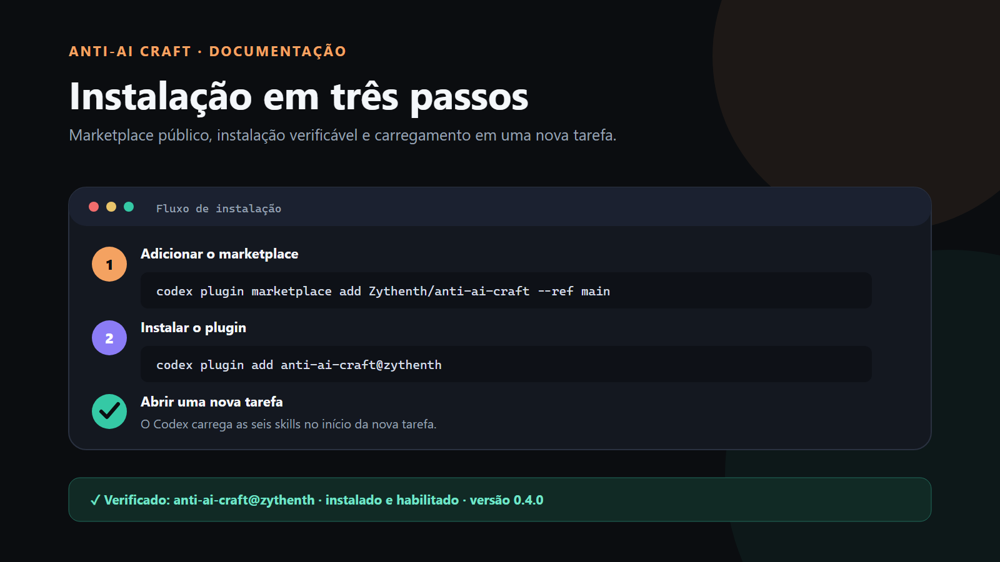
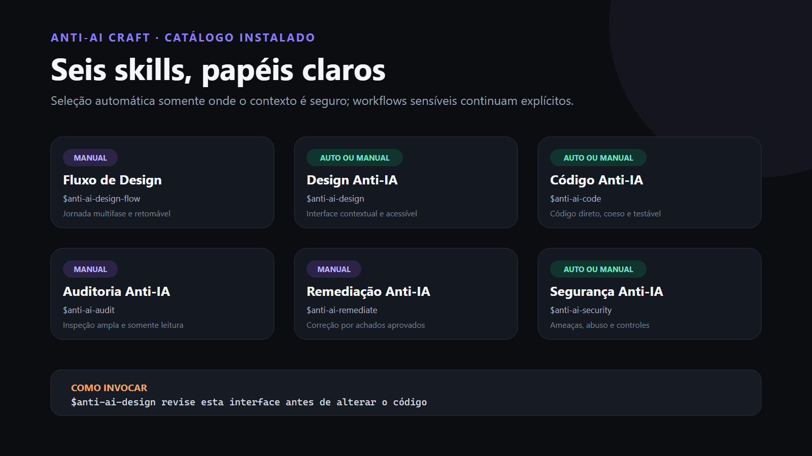
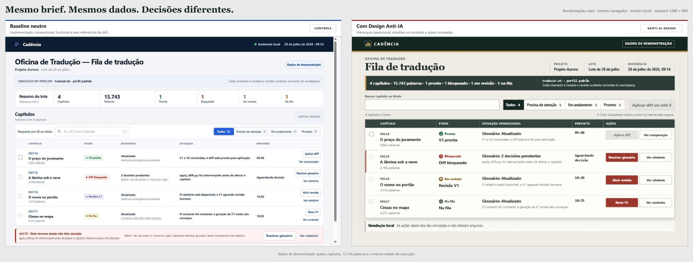
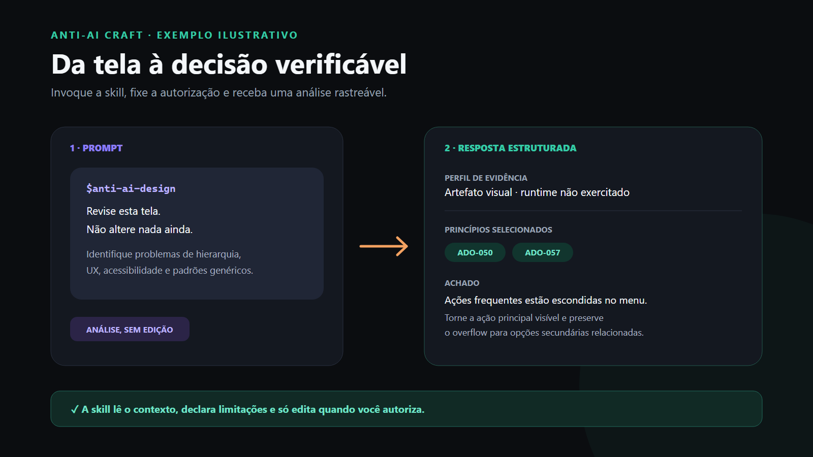

# Anti-AI Craft

Six skills for Codex to run design workflows, create interfaces, produce code, audit, remediate, and analyze security with greater intention, evidence, and control.

“Anti-AI” does not mean detecting authorship or banning the use of AI. The goal is to reduce recurring patterns of poorly conducted automated work: generic interfaces, unnecessary abstractions, silent fallbacks, changes without evidence, out-of-scope fixes, and overlooked security controls.

## Quick overview

### Installation



### Available skills



### Controlled comparison

A neutral baseline and a version guided by `$anti-ai-design`, implemented by independent
agents from the same brief, fixture, interactions, and 1280 × 800 viewport. A third agent
audited their equivalence; both versions passed the same functional flow in the browser.
The capture makes it possible to compare hierarchy, density, context, and access to
actions without presenting the baseline as a broken screen.



[View the comparison brief, executable code, and audit](docs/comparison-demo/AUDIT.md).

### Using a skill

Illustrative example of invocation and the expected response; this is not a capture
of the Codex application.



## What the plugin offers

| Skill | Identifier | Invocation | When to use |
|---|---|---|---|
| [Anti-AI Design Flow](plugins/anti-ai-craft/skills/anti-ai-design-flow/SKILL.md) | `$anti-ai-design-flow` | Manual | Guide a feature through three or more phases, with checkpoints and resumption |
| [Anti-AI Design](plugins/anti-ai-craft/skills/anti-ai-design/SKILL.md) | `$anti-ai-design` | Automatic or manual | Plan, review, or implement contextual, accessible, responsive, outcome-oriented interfaces |
| [Anti-AI Code](plugins/anti-ai-craft/skills/anti-ai-code/SKILL.md) | `$anti-ai-code` | Automatic or manual | Produce or review direct, cohesive, testable code without speculative complexity |
| [Anti-AI Audit](plugins/anti-ai-craft/skills/anti-ai-audit/SKILL.md) | `$anti-ai-audit` | Manual | Examine code and interfaces by severity without changing files |
| [Anti-AI Remediation](plugins/anti-ai-craft/skills/anti-ai-remediate/SKILL.md) | `$anti-ai-remediate` | Manual | Fix only confirmed, reproducible, and approved findings |
| [Anti-AI Security](plugins/anti-ai-craft/skills/anti-ai-security/SKILL.md) | `$anti-ai-security` | Automatic or manual | Model threats, analyze abuse paths, and fix authorized risks |

The identifiers and official names are in English so they remain stable across prompts, scripts, and documentation. Anti-AI Design, Anti-AI Code, and Anti-AI Security may be selected automatically when the request matches their triggers; all six skills also accept manual invocation. Anti-AI Design Flow, Anti-AI Audit, and Anti-AI Remediation require the explicit identifier. Requests for a broad audit or the application of numbered findings still require `$anti-ai-audit` or `$anti-ai-remediate`.

## Installation

Prerequisites:

- Codex CLI with support for the `codex plugin` command;
- Git available on the system.

Add this repository as a marketplace:

```bash
codex plugin marketplace add Zythenth/anti-ai-craft --ref main
```

Install the plugin:

```bash
codex plugin add anti-ai-craft@zythenth
```

Start a new task in Codex after installation to load all six skills.

To confirm that the marketplace was recognized:

```bash
codex plugin list --marketplace zythenth
```

## How to use

Invoke a skill through the skill selector or mention its identifier directly:

```text
$anti-ai-design-flow guide this feature from briefing through review and maintain resumable checkpoints

$anti-ai-design review this interface before changing the code

$anti-ai-code simplify this module without changing its behavior

$anti-ai-audit audit this repository without editing files

$anti-ai-remediate apply only the findings I approved

$anti-ai-security look for abuse paths and fix only authorized risks
```

There is no command such as `/anti-ai-craft/design`. Each skill is invoked through its own identifier.

## Complete workflow

Use `$anti-ai-design-flow` only for a multiphase journey: discovery and brief, information architecture, visual system/tokens, a plan divided into verifiable slices, a security gate when applicable, authorized implementation, review, and optional remediation.

The workflow:

- checks the project before asking questions;
- reuses or skips phases only when existing output is current and supported by evidence;
- does not treat planning as authorization to edit;
- maintains a checkpoint of decisions, artifacts, blockers, and the next action;
- invalidates only the dependents of a changed decision;
- preserves a read-only audit and remediation through approved IDs.

For a screen, component, screenshot, or scoped visual adjustment, continue using `$anti-ai-design`.

## Outcome-oriented design

`$anti-ai-design` includes an original catalog of 101 principles for product
interfaces. They are organized into ten areas: context and strategy; positioning and
promise; acquisition; onboarding and activation; product structure and features;
pricing and monetization; retention and offboarding; ethical choice architecture;
metrics and experimentation; and AI differentiation and delivery.

The skill loads only the relevant areas and selects no more than three principles
per decision. Each principle states when it applies, which decision it guides, what
evidence can support it, and which abuse must be avoided. Business metrics are
treated as hypotheses subordinate to the person's outcome: the catalog does not
authorize false urgency, fabricated social proof, difficult cancellation,
unnecessary data collection, or any other manipulative pattern.

## Which skill to choose

| Goal | Skill |
|---|---|
| Complete, multiphase, resumable journey | `$anti-ai-design-flow` |
| Visual direction, UI, responsiveness, or accessibility | `$anti-ai-design` |
| Implementation or review of a scoped module or diff | `$anti-ai-code` |
| Broad, read-only inspection | `$anti-ai-audit` |
| Fixes for findings that have already been numbered and approved | `$anti-ai-remediate` |
| Threat model, authorization, isolation, rate limits, or abuse | `$anti-ai-security` |

For a broad audit, prefer `$anti-ai-audit`. For security risks, use `$anti-ai-security`. To apply fixes that have already been approved, use `$anti-ai-remediate`.

## Principles and limits

- Anti-AI Design, Anti-AI Code, and Anti-AI Security may be selected automatically by Codex based on the request.
- Anti-AI Design Flow, Anti-AI Audit, and Anti-AI Remediation require explicit invocation.
- Automatic invocation does not expand authorization to read, edit, or take external action.
- Project rules and functional or normative requirements take precedence over heuristics.
- Analysis does not authorize editing; each skill preserves the scope granted by the user.
- An audit is always read-only.
- Remediation requires confirmed and approved findings.
- No skill authorizes commit, push, or any other external action on its own.
- The package does not include apps, MCP, hooks, executables, telemetry, or external services.

## Updating

Update the marketplace snapshot and reinstall the plugin:

```bash
codex plugin marketplace upgrade zythenth
codex plugin add anti-ai-craft@zythenth
```

Then start a new task to ensure that Codex loads the current version.

The marketplace upgrade may point to a new plugin revision. The process above
remains the simplest; in sensitive environments, review the release notes and diff
before updating. The default branch is not an immutable reference.

## Uninstallation

Remove the plugin:

```bash
codex plugin remove anti-ai-craft@zythenth
```

If you do not use any other plugin from this marketplace, you can also remove it:

```bash
codex plugin marketplace remove zythenth
```

## Repository structure

```text
.
├── .agents/plugins/marketplace.json
├── docs/analyses/
├── plugins/anti-ai-craft/
│   ├── .codex-plugin/plugin.json
│   └── skills/
└── README.md
```

Each skill keeps its primary contract in `SKILL.md` and specialized references in its own directory.
The reports under `docs/analyses/` record the technical evaluation used to evolve
the plugin and the final coverage review.

## Contributing

Reports of unexpected behavior, suggestions, and pull requests are welcome. When proposing a change, preserve the public skill identifiers, keep analysis and editing as separate permissions, and include an objective way to verify the result.
